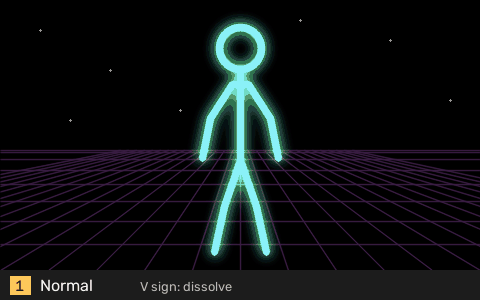

# VanishCam

Vanish from your webcam with a gesture, live in Meet, Zoom or any camera app.
Runs locally on macOS, Linux and Windows. Nothing is recorded or uploaded.



## Effects

| Key | Effect | Gesture |
| --- | --- | --- |
| `1` | Normal | V sign: dissolve |
| `2` | Naruto | Palms pressed together: smoke, a log stays behind |
| `3` | Particles | V sign: blown away in the wind |
| `4` | Goku | Two fingers on the forehead: teleport (repeat to return) |
| `5` | Itachi | Arms crossed over the chest: flock of crows (repeat to return) |
| `6` | Snap | Finger snap: puff of smoke (snap again to return) |
| `7` | Clones | Index and middle fingers of both hands crossed (+): live shadow clones (repeat to dismiss) |

## Install

Needs Python 3.11–3.13 and a virtual camera driver (below).

```sh
git clone https://github.com/jakub-tucek/vanishcam.git
cd vanishcam
./vanishcam          # Windows: vanishcam
```

The first run sets up `.venv` and downloads the MediaPipe models.

### Virtual camera (one-time)

<details>
<summary><b>macOS</b>: OBS Virtual Camera</summary>

1. `brew install --cask obs`
2. Open OBS, click **Start Virtual Camera** and approve it in **System Settings → General →
   Login Items & Extensions → Camera Extensions**.
3. Quit OBS. VanishCam only needs the driver.

Allow your terminal under **Privacy & Security → Camera** when asked.

To keep only the driver (~487 MB → ~5 MB), run
`rm -rf /Applications/OBS.app/Contents/{Frameworks,PlugIns,Resources}`. OBS itself stops
working. `brew reinstall --cask obs` undoes it.
</details>

<details>
<summary><b>Linux</b>: v4l2loopback</summary>

```sh
sudo apt install v4l2loopback-dkms
sudo modprobe v4l2loopback devices=1 exclusive_caps=1 card_label="VanishCam Virtual Camera"
```

`exclusive_caps=1` makes Chrome list it. To load it at boot, add the module to
`/etc/modules-load.d/` and the options to `/etc/modprobe.d/`. You need to be in the
`video` group.
</details>

<details>
<summary><b>Windows</b>: OBS Virtual Camera</summary>

Install [OBS Studio](https://obsproject.com) 30+ and keep it closed while VanishCam runs.
Enable **Settings → Privacy & security → Camera → Let desktop apps access your camera**.
</details>

## Use

1. Run `./vanishcam`, step out of frame for 4 s so it can capture the empty room.
2. In Meet or Zoom, pick **OBS Virtual Camera** (or your loopback device on Linux).
3. Step back in and do the gesture. The preview shows what it sees.

| Key | Action |
| --- | --- |
| `1`–`7` | Switch effect |
| `V` / `R` | Vanish / reappear manually |
| `G` | Gestures on/off |
| `B` | Background: off → blur → images in `backgrounds/` |
| `C` | Next camera |
| `M` | Sound on/off |
| `Space` | Recapture the empty room |
| `F` / `H` / `Q` | Fullscreen / hide buttons / quit |

Your effect, camera, background and mute choices are remembered. Run
`./vanishcam --help` for all options (`--mode`, `--camera`, `--background`,
`--gesture-debug`, …).

## Troubleshooting

| Problem | Fix |
| --- | --- |
| *Virtual camera busy* | Quit OBS, or whatever else uses the loopback device. |
| *No virtual camera driver* | Do the virtual camera setup above. |
| Meet shows black | Reselect the camera or restart Chrome. On macOS, reboot once after installing OBS. |
| Gesture isn't detected | Keep your hands fully in view. `--gesture-debug` prints what's measured. |
| You stay visible after vanishing | Press `Space` and stay out of frame during the capture. |

## Development

```sh
.venv/bin/pip install -r requirements-dev.txt
.venv/bin/python -m pytest -q
./vanishcam --self-test                       # models and assets, no camera
.venv/bin/python tools/make_demo_gif.py       # regenerate docs/demo.gif
```

Fork of [Nicovic17/vanish_webcam](https://github.com/Nicovic17/vanish_webcam). Uses Google
MediaPipe models.
